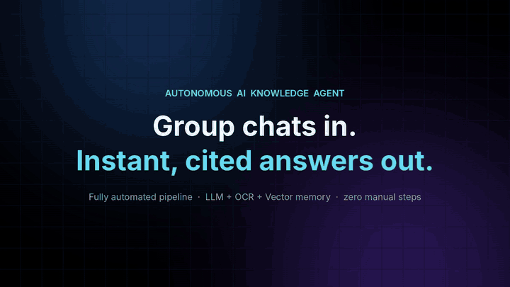

# AI Knowledge Agent: Group Chats In, Cited Answers Out (Case Study)

> An AI agent that turns busy group chats into a searchable knowledge base, and answers questions with the exact message the answer came from.

**Role:** Product owner. I designed the pipeline and directed the build with AI coding tools · **Code:** private · **Demo:** below

▶️ **[Watch the full 60-second video with sound](ai-knowledge-agent-demo.mp4)**

---

## The problem

Every business has that one WhatsApp group where all the answers are: how to renew a permit, which supplier to call, what the new price is. The answer was given once, weeks ago, and now nobody can find it. People ask again, someone answers again, and the knowledge never builds up.

## What it does

The agent works in four steps, with no manual work in between:

| Step | What happens |
|---|---|
| **1. Listen** | A live listener captures every new message, including images, PDFs, slides, voice notes and contacts. |
| **2. Understand** | An LLM sorts each message into *question*, *answer* or *chatter* (chatter is dropped). Replies are linked back to the question they answer, even across quotes and time gaps. Images and documents are read with vision OCR, and voice notes are transcribed. |
| **3. Protect** | A privacy filter runs **before anything is stored** and removes card numbers, bank details, passwords, IP addresses and other private information. |
| **4. Remember & answer** | Questions and answers go into a searchable knowledge store. Ask it something and it replies with the answer **and the message it came from**. If it doesn't know, it says *"I don't have that yet"* and flags the question for a person, without guessing. |

## Design choices I care about

- **Honest answers over clever ones.** Every answer is cited. No source means no answer, and the question goes to a human.
- **Privacy first.** Sensitive details are filtered out before storage, not cleaned up afterwards, and the filter runs again on every batch.
- **Built to keep running.** Queued, retried and de-duplicated processing, with checkpoints so it syncs only what's new each cycle.
- **Time-aware.** Facts that go out of date (prices, deadlines) can expire, so old answers don't mislead people.

## Stack

Node.js · Python (FastAPI) · LLM agents · Vision OCR (Tesseract + vision LLM) · Whisper speech-to-text · Supabase Postgres with pgvector (full-text + semantic search) · Docker · REST ingest API

## Where it fits

Any team that runs on group chats: retail store groups, distributor and dealer networks, factory floors, sales teams and community groups. The same pipeline can feed an internal help bot, an FAQ page or a training guide for new staff.

---

**Want something like this for your team's chats, documents or inbox?**
[Upwork](https://www.upwork.com/freelancers/~01c726d9217f6052ca) · [LinkedIn](https://www.linkedin.com/in/sagar-m-902965416) · mahindrasagarofficial@gmail.com
